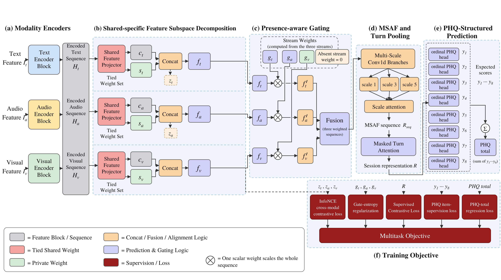

# DeGaMS

**DeGaMS** (**De**composed **Ga**ted **M**ulti-**S**cale) is a multimodal depression-assessment
network that decomposes each modality into shared and modality-specific subspaces, fuses them
through a presence-aware gate that is robust to missing modalities, and predicts PHQ-8 through
eight ordinal item heads.

This repository contains the feature-extraction and training code for the three corpora reported
in the paper (DAIC-WOZ, E-DAIC, CMDC). It does **not** contain any clinical data — see
[Data availability](#data-availability).

## Architecture



The figure is the Section 3.4 forward pass. Dashed arrows are training losses. They do not re-enter the forward path.

- Modality encoders map the turn features \(I_t\), \(I_a\), and \(I_v\) to \(H_m \in \mathbb{R}^{T \times 256}\).
- Shared–specific decomposition uses one weight-tied map \(W_{sh}\) and a private map \(W_m\): \(c_m = \mathrm{L2Norm}(W_{sh} H_m)\), \(s_m = \mathrm{L2Norm}(W_m H_m)\), and \(f_m = [c_m \| s_m] \in \mathbb{R}^{T \times 512}\).
- \(z_t, z_a, z_v\) are masked turn-attention pools of \(c_t, c_a, c_v\). They are the inputs of \(\mathcal{L}_{cmc}\) only.
- The Presence-Aware Gate sets an absent stream’s logit to \(-\infty\), uses \(\tau_g = 1.5\), and floors each present stream by \(\varepsilon = 0.08\) clipped at \(0.95/N_{\mathrm{pres}}\). Fusion is \(F = N_{\mathrm{pres}} \sum_m g_m f_m\).
- Multi-scale attention fusion applies standard Conv1d kernels \(\{1,3,5\}\) (not depthwise), then masked turn attention pools the sequence to the session vector \(R \in \mathbb{R}^{512}\).
- Eight ordinal heads give \(y_i = \sum_{j=0}^{3} j \cdot p_{i,j}\) and \(\mathrm{PHQ} = \sum_{i=1}^{8} y_i\).
- \(\mathcal{L} = 0.004\,\mathcal{L}_{\mathrm{SupCon}} + 0.01\,\mathcal{L}_{\mathrm{MSE}} + \lambda_{\mathrm{KL}}\mathcal{L}_{\mathrm{KL}} + 0.05\,\mathcal{L}_{\mathrm{cmc}} + 0.02\,\mathcal{L}_{\mathrm{gate\text{-}ent}}\). \(\lambda_{\mathrm{KL}}\) is 0.8 on DAIC-WOZ and E-DAIC, and 2.0 on CMDC.

Diagnostic plots for the reported runs are in `figures/`.

## Code availability (double-blind)

For anonymous peer review, use the Anonymous GitHub mirror linked in the manuscript
(generated via [anonymous.4open.science](https://anonymous.4open.science/)).
The public repository will be linked here after acceptance.

## Citation

> Citation will be added once the paper is accepted.

```bibtex
@article{degams,
  title   = {},
  author  = {},
  journal = {},
  year    = {},
  doi     = {}
}
```

## Requirements

Reference environment used to produce the reported results:

| | |
|---|---|
| Python | 3.14.0 |
| PyTorch | 2.11.0 + CUDA 12.8 |
| OS | Windows 11 (26100) |
| GPU | NVIDIA RTX 5090, 32 GB |

```bash
pip install torch==2.11.0 torchaudio==2.11.0 --index-url https://download.pytorch.org/whl/cu128
pip install -r requirements.txt
```

Pretrained encoders are downloaded from the Hugging Face Hub on first use:

| Modality | Corpus | Checkpoint |
|---|---|---|
| Text | DAIC-WOZ, E-DAIC | `mental/mental-bert-base-uncased` |
| Text | CMDC | `hfl/chinese-roberta-wwm-ext` |
| Audio | DAIC-WOZ, E-DAIC | `facebook/wav2vec2-base` |
| Audio | CMDC | `TencentGameMate/chinese-wav2vec2-base` |

Visual features for DAIC-WOZ / E-DAIC use the **official corpus-released OpenFace 2.1.0**
Pose/Gaze/AU CSVs (E-DAIC filenames `*_OpenFace2.1.0_Pose_gaze_AUs.csv`; DAIC from the
official interview archives)—see `DAIC/visual/extract_openface_visual_210.py`. We do **not**
re-run a local OpenFace binary for the reported results. Optionally,
[DeepFilterNet](https://github.com/Rikorose/DeepFilterNet) may be used for speech enhancement;
the audio extractor degrades gracefully if it is absent (DeepFilterNet → `noisereduce` →
raw + Silero VAD → energy VAD), so it is not required to reproduce the results.

## Data availability

**No data, labels, or extracted features are distributed with this repository.** All three
corpora are access-restricted and must be requested directly from the originating institutions
under their own data-use agreements:

| Corpus | Source | Access |
|---|---|---|
| DAIC-WOZ | USC Institute for Creative Technologies | https://dcapswoz.ict.usc.edu/ |
| E-DAIC | USC ICT (AVEC 2019 DDS) | https://dcapswoz.ict.usc.edu/ |
| CMDC | Chinese Multimodal Depression Corpus | Request from the corpus authors |

Once access is granted, place the raw releases on disk and point the scripts at them (see
[Quickstart](#quickstart)). The label files used for the splits ship with the official corpus
releases; we add no annotations of our own.

## Repository structure

```
DeGaMS/
├── README.md
├── LICENSE
├── requirements.txt
├── _shared/                       # modules imported by every corpus
│   ├── degams_model.py            # DeGaMSConfig, DeGaMSModel, degams_total_loss
│   ├── clean_v2_paths.py          # feature-tree layout and front-end constants
│   ├── audio_front_vad.py         # VAD / turn-slicing helpers
│   └── cuda_exit.py               # Windows CUDA teardown-safe process exit
├── DAIC/
│   ├── PIPELINE.md                # exact extraction order for this corpus
│   ├── Text/                      # MentalBERT turn embeddings, Ellie-turn removal
│   ├── audio/                     # VAD mel, wav2vec 2.0 (VAD and enhanced variants)
│   ├── visual/                    # OpenFace-29, DenseNet-201 PCA-768, OF∥DN concat
│   └── _dataset_train/            # Dataset, feature-tree builders, training entry points
├── E-DAIC/
│   ├── PIPELINE.md
│   ├── Text/  audio/  visual/  _dataset_train/
├── CMDC/
│   ├── PIPELINE.md
│   └── Text/  audio/  visual/  _dataset_train/
└── figures/
    ├── Fig01_DeGaMS_Overall_Architecture.png
    └── Fig02–Fig11, FigA1 diagnostic plots
```

All three corpora follow the same convention: `Text/`, `audio/`, and `visual/` encode the raw
signal into per-modality turn features, while `_dataset_train/` assembles those features into the
feature tree, defines the `Dataset` (including split loading and leakage assertions), and holds
the training entry point. Each corpus directory is self-contained apart from `_shared/`; `E-DAIC`
and `CMDC` additionally reuse the Dataset and training loop defined in `DAIC/_dataset_train/`.

## Quickstart

### 1. Install

```bash
git clone <anonymous-repository-url> DeGaMS && cd DeGaMS
python -m venv .venv && .venv\Scripts\activate
pip install torch==2.11.0 torchaudio==2.11.0 --index-url https://download.pytorch.org/whl/cu128
pip install -r requirements.txt
```

The shared modules are resolved via `PYTHONPATH` rather than an installed package, so set it once
per shell from the repository root:

```powershell
$env:PYTHONPATH = "$PWD\_shared;$PWD\DAIC\_dataset_train;$PWD\E-DAIC\visual"
```

### 2. Extract features

Point `DEGAMS_ROOT` at the directory holding the raw corpora (`DAICWOZ/`, `EDAIC/`, `CMDC/`) and
the generated `egemaps_experiment/` feature tree:

```powershell
$env:DEGAMS_ROOT = "/path/to/degams_data"
```

Then follow the per-corpus order in `PIPELINE.md`, which is dependency-ordered
(text → audio → visual → assemble):

```bash
python DAIC/Text/extract_text_features.py          # then the rest of DAIC/PIPELINE.md
python E-DAIC/Text/extract_edaic_features.py       # then E-DAIC/PIPELINE.md
python CMDC/Text/reextract_cmdc_text_cls_mean.py   # then CMDC/PIPELINE.md
```

The result is a per-corpus feature tree (`text/`, `wav2vec/`, `visual/`, `mel/`) which the
Datasets consume. Everything is configured by environment variable; no source edits are needed:

| Variable | Default | Meaning |
|---|---|---|
| `DEGAMS_ROOT` | `/path/to/degams_data` (required) | Root holding the raw corpora and the generated feature tree |
| `DEGAMS_FEATURE_ROOT` | derived from `DEGAMS_ROOT` | Feature-tree root for the active corpus. Set it to `degams_avboost_v1/<corpus>` (DAIC, E-DAIC) or `degams_cmdc_tav` (CMDC) to reproduce the reported results. |
| `DEGAMS_RUN_ROOT` | `<repo>/runs` | Where training runs write checkpoints and `SUMMARY.json` |
| `DEGAMS_CMDC_FOLD` | `1` | Active CMDC fold, `1`–`5` |
| `DEGAMS_AVBOOST` | unset | Legacy in-place substitution route for DAIC/E-DAIC; **not** used by the reported runs and mutually exclusive with `DEGAMS_FEATURE_ROOT`. See `DAIC/PIPELINE.md`. |

You **must** set `DEGAMS_ROOT` before extraction or training. This repository does not ship machine-specific absolute paths.

### 3. Train

```bash
# DAIC-WOZ — full gated DeGaMS, DEV-selected seed sweep
python DAIC/_dataset_train/train_daic_degams_seed_sweep.py --num_seeds 5 --epochs 50

# E-DAIC
python E-DAIC/_dataset_train/train_edaic_degams_seed_sweep.py --num_seeds 5 --epochs 100

# CMDC — repeat for --fold 1..5
python CMDC/_dataset_train/train_cmdc_degams_seed_sweep.py --fold 1 --num_seeds 5 --epochs 50
```

Each run writes per-seed summaries, the selected checkpoint, and a `SUMMARY.json` with the final
test metrics into the run directory.

To reproduce the fusion ablation, disable the Presence-Aware Gate and fall back to equal-sum
fusion with `--fusion-mode equal` (equivalently `--ablate-gate`); `--ablate-decomp` removes the
shared–specific subspace decomposition.

## Reproducibility

- **Seeding.** `set_seed(seed)` resets `random`, NumPy, and the CPU/CUDA generators, and sets
  `cudnn.deterministic = True`, `cudnn.benchmark = False`. Feature extraction runs at a fixed
  `GLOBAL_SEED = 42` and additionally pins `PYTHONHASHSEED`.
- **Seed sweeps.** Training sweeps consecutive seeds (`range(start_seed, start_seed + num_seeds)`,
  default 5 seeds from 0) rather than a hand-picked seed list.
- **Locked splits.** DAIC-WOZ and E-DAIC use the official AVEC partitions verbatim
  (`train_split_Depression_AVEC2017.csv`, `dev_split_Depression_AVEC2017.csv`,
  `full_test_split.csv`). CMDC uses five pre-generated subject-disjoint folds under
  `CMDC/label/video_fold{1..5}/`; the Dataset asserts `train ∩ dev ∩ test = ∅` at construction
  and fails fast on leakage.
- **No test-set selection.** The checkpoint and the PHQ decision threshold are chosen by DEV
  Macro-F1 only. The test split is evaluated exactly once, with the DEV-selected threshold.
- **PCA fitted on TRAIN only.** The DenseNet-201 → 768-D visual projection is fitted on TRAIN
  subjects and then applied to DEV and TEST.
- Residual nondeterminism from cuDNN kernel selection and Hugging Face checkpoint revisions may
  shift metrics in the last reported digit.

## License

Code in this repository is released under the MIT License — see [`LICENSE`](LICENSE).

The datasets are **not** covered by the code license. DAIC-WOZ, E-DAIC, and CMDC remain subject
to their respective data-use agreements, and the pretrained encoders remain subject to their
original licenses.
